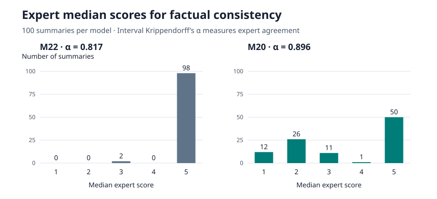
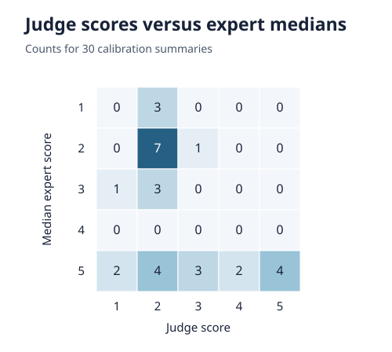

# LLM Judge Calibration

## Abstract

Automated evaluation of factual consistency depends on both the quality of the judge and the reliability of its human reference. I screened human expert ratings for 16 summarization models across four dimensions in SummEval and selected factual consistency for M20, a fine tuned GPT-2 model, based on expert agreement as well as the full distribution of summary scores. Across 100 summaries, interval Krippendorff’s alpha was 0.896. On a calibration set of 30 summaries, GPT-6.2 Sol differed from the expert median by a mean absolute error of 1.23 rubric points (95% bootstrap confidence interval, 0.83 to 1.67), with a quadratic weighted kappa of 0.34. I performed a source review and found cases in which the judge identified factual discrepancies despite high expert ratings and agreement. Adding redundant text increased scores by one point in 4 of 26 pairs, while 28 of 30 calibration summaries received identical scores across three fresh runs. The audit showed why matching expert scores and checking factual consistency can diverge. Future work will audit a sample of labels with a model panel and blinded human review, clarify the rubric for summaries that mix correct and incorrect claims, and compare frozen judge prompts on the 70 reserved evaluation articles.

See [Reproducing the experiments](REPRODUCING.md) for setup and run commands.

## Introduction

I wanted to develop and calibrate an LLM-as-judge evaluator to measure quality of generated open-ended responses. To do so I searched for a publicly available dataset that included human scores which could be used to calibrate the judge. I chose the [SummEval dataset](https://github.com/Yale-LILY/SummEval), which contains 100 news articles and summaries produced by 16 different models, with ratings by three expert human reviewers of each summary on four quality dimensions: relevance, consistency, fluency, and coherence. The articles came from two news sources, and the quality scores ranged from 1 to 5 for each dimension.

My first task was to choose one model that had scores that would allow me to measure agreement among individual experts and evaluate the judge against a benchmark with reasonably consistent ratings and enough variation across the scale.

## Choosing the summarization model

I used M22 (BART) for a quick feasibility check on one model. I wanted to find at least one scoring dimension where the experts agreed reasonably well and their ratings covered enough of the scale to test the judge. Too much disagreement among expert reviewers would indicate issues with the rubric, reviewer training, or review process and make it difficult to create a reliable benchmark for evaluating the judge.

BART fell short on one of those criteria in each dimension. Relevance and coherence showed more variation, but the experts often disagreed (interval Krippendorff’s alpha of 0.193 and 0.257, respectively). Fluency and consistency had the opposite problem. Nearly every expert median was 5, so a judge could match most scores without distinguishing among summaries. I screened all 16 models across the four dimensions to find a combination that met both criteria.

I chose **M20 factual consistency**. It had the highest interval alpha among the model and dimension combinations with at least 20 summaries outside the most common median score. The chart shows why the distribution mattered. For M22 consistency, **98 of 100 summaries** had an expert median of 5, so a judge could match almost every median by assigning 5 throughout. For M20, **50 of 100 summaries** had a median of 5, and the other 50 spanned scores 1 through 4. That gave me examples across the full scale to test how closely the judge scored them.

*Figure 1. Median expert scores for factual consistency. M20 spans all five scores. M22 has 98 summaries at score 5.*

M20 also showed stronger expert agreement on consistency. Its interval Krippendorff’s alpha was **0.896**, compared with **0.817** for M22. M20’s ordinal alpha was **0.870** as a sensitivity check. Of the 300 M20 expert rating pairs, **65.0%** matched exactly and **93.7%** were within one point.

## Building and measuring the judge

I split the 100 M20 summaries into 30 for calibration and 70 for evaluation, balancing article publisher and expert median bands. GPT-6.2 Sol scored one summary at a time using the SummEval consistency instructions adapted for that format. The judge saw the source article, summary, and rubric. It returned a score from 1 to 5 and a brief rationale. A scoring script joined the judge output to the expert median afterward.

On the 30-item calibration set, the automated judge achieved a mean absolute error (MAE) of 1.23 rubric points (95% CI: 0.83 to 1.67), while quadratic weighted Cohen’s kappa (QWK) was quite low, 0.34 (95% CI: 0.14 to 0.58). The judge score matched the expert median on 11 summaries, while it disagreed by one point on 9 summaries. These disagreements were nearly balanced, with the judge scoring higher on 4 summaries and lower on 5. However, disagreement was 2 points or greater on 10 summaries. These bigger disagreements are penalized more by the quadratic weighting, which largely explains the low QWK in this case.

| Calibration metric | Result | 95% bootstrap interval |
| --- | ---: | ---: |
| Mean absolute error (MAE, rubric points) | 1.233 | 0.833 to 1.667 |
| Quadratic weighted Cohen’s kappa | 0.340 | 0.139 to 0.578 |
| Exact match | 11 of 30 (36.7%) | |
| Off by one point | 9 of 30 (30.0%) | |
| Off by two or more points | 10 of 30 (33.3%) | |
| Mean signed gap (judge minus expert median) | −0.967 | |

The judge tended to score lower than the experts. Overall the judge had a mean signed gap of −0.967 compared to the median expert score. Most notably, the judge scored lower than the median expert score on all 10 of the summaries where the difference was two or more points. This score deflation is apparent in the score distributions and confusion matrix below. While the expert medians were skewed toward the top of the scale (with 15 out of 30 summaries rated 5), the judge scores were concentrated much lower in the scale, with a score of 2 on over half (17 of 30) of the calibration summaries.

| Calibration scores | 1 | 2 | 3 | 4 | 5 |
| --- | ---: | ---: | ---: | ---: | ---: |
| Expert median | 3 | 8 | 4 | 0 | 15 |
| Judge | 3 | 17 | 4 | 2 | 4 |

* Counts of judge and median expert ratings of consistency. Exact agreement runs from the upper left to the lower right. Cells to the left of that diagonal show where the judge scored lower than the expert median.*

Summaries where the expert median was 5 accounted for 28 of the 37 total absolute error points, driven primarily by instances where the judge assigned scores of 1 or 2. Audit checks confirmed that these large gaps were not artifacts of data-joining errors. I reviewed five of these summaries and discovered that in each case, the judge found substantial factual inconsistencies that justified a score at least two points lower than the 5 given by the experts. The high ratings by the experts suggest that they may have either overlooked or discounted these inconsistencies. For example, below is a summary of an article about a SpaceX launch test:

"The Falcon 9 rocket was delayed after a major problem with the rocket's second stage. The booster landed on the drone ship, but the rocket exploded. SpaceX hopes to land the rocket first time."

The source article said the launch had been delayed due to weather, not a problem with the second stage, as the summary claims. The article also said that during this test, the rocket tipped over on landing, and the article did not say it exploded. An explosion did occur in prior launch test, according to the article. The judge caught both discrepancies in the summary and scored it 1 for consistency. I think the judge's score was too low, given that the summary did get some facts correct (the booster did land on a drone ship and SpaceX was seeking its first successful booster landing). However, the three human raters apparently overlooked or discounted these inconsistencies, assigning scores of 5, 4, and 5.

Because the expert scores were substantially inflated on all five of the examples I reviewed, I decided postpone efforts to improve the judge until I am able to audit the benchmark and make corrections that are warranted.

## Judge Stability

To quantify judge determinism and establish a baseline for run-to-run variation, I rescored each of the 30 calibration summaries in three additional passes using the same judge, rubric, and setting. All 90 rescoring calls reported zero cached input tokens.

For 28 of the 30 summaries, the three retest scores matched their corresponding original scores. Only two summaries exhibited any score variance, each varying by a single point in two of three score comparisons. Out of the 90 total within-summary score pairs, 86 matched exactly, demonstrating high inherent stability and low noise in the automated judge.

## Judge Bias

Generative models are known to exhibit systematic biases, such as favoring longer responses. I tested whether making a summary longer changed this judge’s consistency score. To leave room for scores to increase, I used the 26 calibration summaries that initially scored below 5. I added one or two sentences restating content from each original summary and scored both versions separately with the same judge and prompt (with all 52 calls reporting zero cached input tokens). The padded score rose by one point in 4 of the 26 summaries, stayed the same in 22, and fell in none, yielding a mean change of +0.15 rubric points.

The stability data provide important context for interpreting the increases in these four padded summaries. For three of the summaries, the judge consistently scored each original version a 2 in the intial run, all stability retests, and in the padding experiment. Each of the padded versions received a 3 from the judge. However, the fourth padded summary preferred by the judge also exhibited score increases on the original version. The original version received a 3 on three runs, in two stability retests it received a 4, the same score given to the padded version.

The score stability paired with increases on longer versions suggests the judge may be biased toward increased length. However, a one point increase was observed for only 3 of 24 padded summaries where original versions were scored consistently. In addition, the sentences added in this experiment also altered the repetition of information. These results indicate the importance of futher investigation with a larger dataset, controlling for repetition as well as length, to get a clearer understanding of length bias for this judge.

## Discussion and Conclusion
Building and evaluating this automated judge provided practical insight into the mechanics of LLM-as-a-judge pipelines. While the initial judge achieved a Mean Absolute Error of 1.23 points and a quadratic weighted kappa of 0.34 against human expert medians, it also discovered issues with the benchmark scores that need futher investigation. In several cases, expert scores were inflated due to human reviewers overlooking or discounting factual inconsistencies in the summaries compared to their source articles. Furthermore, stability and bias testing demonstrated that while the judge is highly stable under invariant inputs, it exhibits mild sensitivity to structural perturbations like padding.

As an initial portfolio project, this exercise gave me insight into the challenges of calibrating automated graders against human reference data. My work on this project in the immediate future will focus on refining the evaluation workflow and improving the benchmark's accuracy. I plan to use a panel of models to identify factual claims and cite evidence from selected articles, including summaries with large judge-benchmark disagreements alongside a random sample of remaining cases. My own blinded review will check proposed benchmark corrections. Once the benchmark is improved, I will reevaluate the judge and look for opportunities to improve it. Based on my work so far, I think it would be worth adding to the rubric explicit guidance for summaries that mix correct and incorrect claims to reduce ambiguity in automated scoring. When I have achieved some improvements in the judge, I will evaulate it on the 70 reserved evaluation articles to benchmark final performance.
